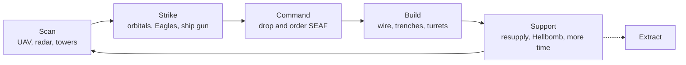
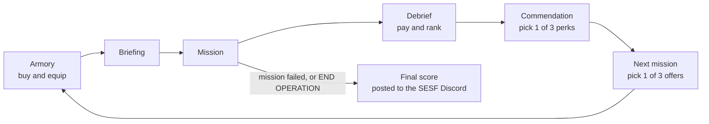
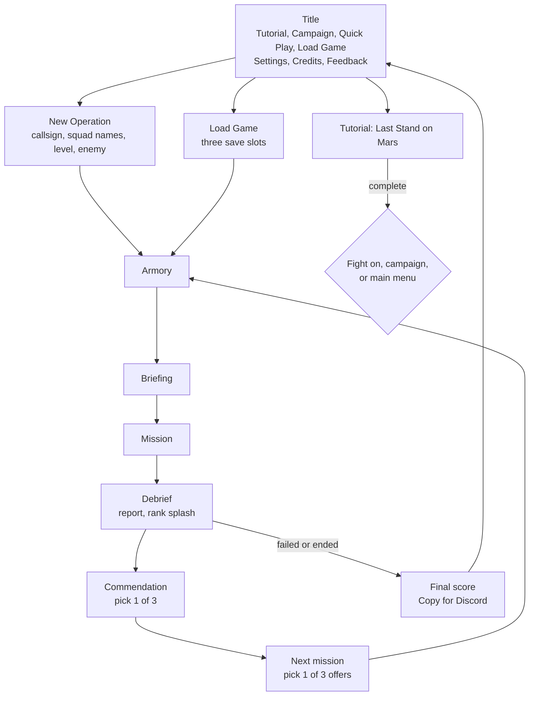

# Orbital Fury: Game Design Document

**Version 0.53.9 · November 2026 · [Play at orbitalfury.com](https://orbitalfury.com)**

This is the blueprint for Orbital Fury: what the game is, how it plays, how its systems fit together, and how it is built. The [README](../README.md) is the player's manual and has every number. This document explains the design.

## Contents

1. [Overview and high-level concept](#1-overview-and-high-level-concept)
2. [Core gameplay and mechanics](#2-core-gameplay-and-mechanics)
3. [Systems and economy](#3-systems-and-economy)
4. [Content and worldbuilding](#4-content-and-worldbuilding)
5. [Art, audio and UI](#5-art-audio-and-ui)
6. [Technical and production details](#6-technical-and-production-details)

---

## 1. Overview and high-level concept

### One-sentence pitch

A free Helldivers 2 fan game in the browser, where you are the gunner on a Super Destroyer and keep four AI Helldivers alive from orbit with strikes, SEAF troops and a defensive line you build.

### Target audience and platforms

| | |
|---|---|
| **Audience** | Helldivers 2 players, first of all the Super Earth Special Forces (SESF) Discord community. They know the stratagems and factions and want a short, shareable game to play between drops and compare scores in the channel. |
| **Secondary audience** | Fans of real-time strategy, tower defence and roguelike runs who enjoy commanding rather than shooting. |
| **Platforms** | Any modern browser on a computer, tablet or phone, including in-app browsers like Discord's. There is nothing to install. |
| **Languages** | English, French and Spanish. |
| **Price** | Free, with no ads, no purchases and no accounts. |

### Design pillars

1. **You are their fire support.** The four Helldivers play themselves. You never give them an order. From level 3 up they lose without you, so every minute you spend covering them, instead of hitting something else, is the choice that makes the game.
2. **Every shot is a risk.** Your strikes land a moment after you call them and hurt your own side. Careful aim beats volume of fire. The ship gun is the one safe tool.
3. **The war only gets worse.** Every mission is harder than the last, pressure inside a mission never eases, and every operation ends eventually. You keep up by getting stronger, until you can't.
4. **Every system is a choice.** Workers or guards, which mission to take next, which troops to bring, whether to pay for more time. More power always comes with a trade-off.
5. **Anywhere, and made from nothing borrowed.** It runs on a phone as well as a computer. Every picture is drawn in code and every sound is synthesised. Nothing is taken from Arrowhead or Sony.

### Player fantasy

**You are the gunship overhead.** You see the battlefield through a thermal camera from orbit. You watch four tiny figures push into enemy territory, and you decide what lands on the ground around them: a railcannon on the charger closing on them, a barrage on the bug hole they haven't seen, a pelican of SEAF troops on the hill they'll need to hold. When they get out, it's because of you.

---

## 2. Core gameplay and mechanics

### Core loop

**Inside a mission** (10 to 15 minutes):



**Across an operation** (a run of missions):



### Controls summary

| Action | Computer | Phone and tablet |
|---|---|---|
| Select troops | Click a trooper; click again for his squad; `Shift`+click to add; drag a box | Tap; double-tap for the squad; hold a finger, then drag, for a box |
| Arm a weapon | `1` UAV, `2` to `6` orbitals, `8` ship gun, `9` artillery cannon; `Q` / `E` cycle | Weapon bar |
| Fire | Click (hold for the ship gun) | **CALL** (hold for the ship gun) |
| Order the selection | Right-click: a post (hold beside it), an enemy (attack), the ground (move), a crate (build) | Tap the map |
| SEAF drop | `G`, then place the ghost | **SEAF DROP**, then **PLACE** |
| Squad orders | `X` auto, `V` move, `Z` protect, `N` attack, `C` escort; `R` draws a route, line or ring | Order buttons; **DRAW** |
| Build | `B`, pick a build, place it; `Q` / `E` turn it | **BUILD** drawer |
| Armory in a mission | `Y` | **ARMORY** |
| Pause and plan | `P` or `Space`; orders given now go out in order on resume | Pause button |
| Half speed | `,` | **1×** button |
| Camera | `WASD`, right-drag, wheel to zoom, `F` follow the squad | Drag, pinch |
| Big map | `Tab` or `L` | Tap the minimap |
| Load a supply pod | `U`, then `1` to `3` | **LOAD POD**, then tap |
| Approve more time | `K` | **APPROVE** |
| Rearm the Eagles early | `0` | Tap an empty Eagle |

Desktop keys can be rebound in Settings.

### Player actions and rules

**The gunner's weapons**

| Weapon | Rules |
|---|---|
| **UAV scan** (slot 1) | Opens a timed circle of vision you can strike into. Allies under it dodge more and move faster. Its radar marks every enemy on the map every few seconds. |
| **Orbital strikes** (slots 2 to 6) | Land only inside the **strike zone** (a ring around allies) or a UAV circle. Each has its own recharge, delay and blast, and all of them hurt allies. |
| **Eagles** | Arrive fast. Each Eagle has a few runs, then flies back to rearm (about 110 seconds). |
| **Minefields** | Only enemies set them off, but the blast hurts anyone near. |
| **Utilities** | Med pod, smoke, shield dome and sentry. They are safe to drop on allies. |
| **Ship gun** (slot 8) | Hold to fire anywhere you can see, with no strike zone needed. It never hurts allies and its ammo refills by itself. It is ready the moment a mission starts. |
| **Artillery cannon** (slot 9) | A mini-nuke on a slow recharge. It needs a crew and hurts allies. |

**Seeing and aiming**

- **The vision ladder.** Allies see farthest. They shoot less far than they see, and throw a stratagem beacon less far than they shoot. The strike zone sits inside what you can see.
- **Fog.** Most of the map is hidden until an ally, a UAV or a tower sees it. Base locations are always known, but their insides are hidden under smoke until scouted.
- **Locked shooters.** An enemy that fires on your allies is marked, and after three seconds it is locked: you can hit it outside the strike zone.
- **The ground.** High ground sees farther and hits harder. Deep water can't be crossed on foot, and mud, snow and sand slow everyone.

**Damage and health**

- **Facing.** Hits from behind do 1.5× damage, and 2.2× on heavies. Every unit shows which way it faces.
- **Critical hits** do double damage. Orbitals crit most often (14%), then the ship gun (10%).
- **Armour and shields.** Heavy armour shrugs off light fire. A charger's front takes only about 60% of a hit. Shields (Harvesters, warp ships, the Colossus) take every hit at full strength, then come back if left alone.
- **Misses.** No enemy attack has accuracy above 90%, so everything can miss.
- **No one-shots.** No single enemy hit takes more than 70% of a Helldiver's health.
- **Helldivers** have 420 health, four stims, six grenades and an Ultimatum (one round that kills nearly anything in about 9 m). The squad has **20 lives per mission**. A dead Helldiver drops back in by pod while lives remain.
- **SEAF troopers** have 100 health. A Medic can revive a downed trooper within 14 seconds. Every trooper lost is paid for at the end of the mission.

**Commanding SEAF**

- **Drops:** each drop comes by pelican as its own squad (S1 to S9), and can land wherever allies can see.
- **Orders:** auto, move, protect, attack and escort. You can also draw a route to run, a line to hold or a ring to defend. A move order is forced: troops keep moving and fire on the go.
- **Pickups:** a pickup point flies troops back to the destroyer. They come back down on a shorter turnaround.
- **Garrisons:** troops sent inside a building leave their squad and make the building work better.

**Building**

- **Placing:** pick a build, place its see-through ghost, and pay when you order it. A cargo pelican drops a crate, and the nearest squad (or the one picked) builds it.
- **Queue:** a squad moves on to the next unbuilt placement by itself.
- **Chaining:** wire and foxholes snap onto the free end of the last section, so a line is laid one piece at a time.
- **Demolish:** a building blows up after a three-second fuse, hurting enemies around it.
- **Restriction:** nothing can be built on a standing enemy base.

**Time controls**

- **Pause:** stops the game. You can still look around and plan orders, builds and strikes, which go out in order when you play on.
- **Half speed:** everything still works.

### Win and lose conditions

| Result | When | What it means |
|---|---|---|
| **Victory** | The objective is done and the squad extracts by pelican | Full pay |
| **Objective complete** | The objective is done, but the squad is lost or the clock runs out before extracting | The mission counts, without the extraction pay |
| **Defeat** | All 20 lives are lost, or the 30-minute clock runs out, before the objective is done | The mission fails. Retry it, or the operation ends |
| **Retired** | You leave from the pause menu | Always counts as a failed mission |

**Ending an operation:**

- **Failure:** an operation ends when a mission fails and isn't retried.
- **By choice:** press **END OPERATION** after any counted mission. Ending this way pays an SESF coin.
- **Score:** the final score is the credits earned over the operation.

**The tutorial** is won when 70 people have been evacuated from Mars. After that you can fight on until the base falls.

---

## 3. Systems and economy

### Progression systems

**Inside an operation**

| System | How it works |
|---|---|
| **Ranks** | One rank per mission finished, nine in all, from *Fresh Recruit* to *Super Earth's Favorite Gunner*. Each pays a level bonus (400 to 4,000 credits) and opens more of the armory. The ranks in between have names like *Liber-Tea Sommelier* and *Senior Button Presser*. |
| **The armory** | Everything is visible from the start. What your rank hasn't reached shows the rank it needs. New unlocks pulse and say NEW. |
| **Commendations** | After each mission, pick one of three perks that lasts the operation: **Orbital Efficiency**, **Hangar Crews**, **Gun Overcharge**, **Veteran Troops** or **Engineering Corps**. They stack, up to 10 per operation. |
| **Classified** | Ranks 6 to 9 each unlock one over-the-top stratagem. |
| **Retry** | Any mission can be flown again from the moment of the drop: same map, same enemy, and your credits and kit as they were. |

**Across operations**

- **SESF coins:** ending an operation yourself pays one (you can hold up to 3). A coin is a credit deposit toward any armory item in a later operation, worth more the further the ended operation got.
- **Campaign checkpoints:** a cleared chapter stays cleared. The next chapter carries on with the kit, credits and rank you had when the last one was cleared.

**What never grows:** the Helldivers themselves. They can't be upgraded, so your support is the only thing that makes them stronger.

### In-game economy

There is one currency, **credits**.

| Credits come from | Credits go to |
|---|---|
| Kills (specials pay 3×) | Unlocking stratagems and utilities |
| Destroyed bases, targets and super heavies | Upgrades: orbitals, ship gun, UAV, strike zone, SEAF, Hangar, buildables |
| The objective, side missions and a full clear | Builds in a mission (each one paid when ordered) |
| Extraction | SEAF losses, billed at the end of each mission, each one dearer than the last |
| Work sites, paid as they are worked | Time extensions the squad asks for |
| Strongboxes found on the map | |
| Rank bonuses and SESF coins | |

**Pay modifiers:**

- **Level:** credits scale with the level, from ×0.75 at level 1 to ×1.20 at level 10.
- **Offer bump:** a mission offer pays 15% more for each level of difficulty bump it carries.
- **Operation bonus:** pay rises with each mission already done in the operation.

**Spending rules:**

- **Pay toward:** you can put credits toward any item and finish paying later. A deposit can't be taken back.
- **Mid-mission buys:** the armory stays open during a mission (`Y`), and the war goes on while you shop.
- **Pricing target:** prices are set so that a session of about three hours earns enough to buy everything.

**Score** is the total credits earned over the operation, so taking riskier offers raises it.

**The armory's tabs**

| Tab | What it sells |
|---|---|
| **ORBITALS** | Orbital strikes, utilities and minefields, and their levels. All five slots are open from the start. |
| **HANGAR** | Eagles; Pelican Fleet (up to six pelicans) and Pelican Bay (bigger drops). |
| **SHIP** | The ship gun (Gun Barrels, Gun Ammo Bay, Ammo Synthesizer, Gun Stabilizers), the UAV (scan levels, Target Relay, Threat Warning) and the Strike Zone Range. |
| **SEAF** | SEAF Barracks (more troops, no top level), SEAF Armor and Rifles, G-12 Grenades, Specialists, Field Medics, Leader Command, Combat Engineers, and troop mixes (standard, assault, armour, medical). |
| **BUILDABLES** | Unlocks and levels for every build except the free foxhole and wire. |
| **CLASSIFIED** | Orbital Liberty Storm, Eagle Squadron, Democracy Lance and Super Earth's Final Word. |

### Artificial intelligence

**The Helldivers (the squad)**

The squad decides everything itself (`js/sim/planner.js`):

- **The plan:** go for the main objective, taking side missions and bases near the way while the clock allows.
- **Bases:** they mark an enemy base and wait about 18 seconds before going in, which gives you a window to soften it.
- **Defences:** at a site they must hold, they take 25 quiet seconds to man the walls facing the threat.
- **Breaking off:** they pull back when a fight is lost (three deaths close together, or a big wave coming) to a quiet side task or a scored fallback point.
- **After the objective:** with more than three lives, they go for a **full clear** of the map 4 times in 5. Near the end of the clock they may ask you for up to 2 more minutes, once. Otherwise they head for extraction.
- **Extraction:**
  - A Helldiver calls the pelican, and the squad holds the pad.
  - Everyone gathers 15 seconds before the pelican lands.
  - A squad wiped after the call drops back near the pad.
  - The pelican waits for Helldivers who are still coming.
- **Their own stratagems:** each Helldiver calls his own on his own clock, always including orbitals and heavy weapons. They use grenades and the Ultimatum on crowds and heavies, and share them out so two don't go at the same target.
- **Talking to you:** they radio what they're about to do, ping where they're going, and ask for supplies or time.

**SEAF**

- **Orders:** they follow your orders and fight what they meet.
- **Cover:** they take cover close by when a fight starts, and stay in cover rather than stepping out to shoot.
- **Leaders:** if the Squad Leader falls, the senior trooper takes over.
- **Roles:** Specialists brace their MG and fire EATs at heavies, and Medics stim and revive.
- **Building:** they build, repair posts when nothing is shooting at them, and return to what they built.

**The enemy**

| Faction | Behaviour |
|---|---|
| **Bugs** | Swarm in loose packs from every side and fight up close. Chargers run at the squad. |
| **Bots** | Slow. They stand off, form a firing line, and see farthest. The Commander blocks every strike inside its ring. |
| **Squids** | Spread out and surround their target. Harvesters project a shield bubble over the squids around them. |

**Enemy awareness:**

- **Bases** sleep until someone enters their detection range or hits them. Then the garrison turns out, the base keeps sending groups one at a time, and neighbouring bases follow.
- **Patrols** walk their own routes and come over when they hear fighting. Rifles, blasts, strikes and the ship gun each carry a different distance.
- **Flares:** a patrol that sees the squad may fire one. If the holder isn't killed within about four seconds, reinforcements come by bug hole, dropship or warp ship.

**The director**

The director keeps the pressure on (`js/sim/director.js`):

- **Defended sites:** backup arrives at any site the squad is working, from two sides.
- **Off the map:** patrols walk in from the edge for the whole mission, so the enemy never runs out.
- **Extraction:** waves get bigger the higher the alert.
- **Caps:** limits on the field keep the numbers playable.

**The alert level** works like a wanted level, shown on the HUD from CALM to EXTERMINATION.

- **Spike:** attacking a base raises it, and destroying the base clears it.
- **Ratchet:** every base destroyed, objective done, extraction called and time extension raises the baseline for good.
- **Response:** higher alert brings new kinds of response, not just more enemies.

**Difficulty scaling**

You pick the starting level from 1 to 10. It has no ceiling: past 10 come *Super Helldive +1*, *+2* and so on. Each level sets two things:

- **How many come:** patrols, backup, group sizes, the field cap, and how often mediums, heavies and super heavies appear.
- **How far the war has gone:** measured in "war minutes", it sets the enemy's toughness and damage, how fast pressure builds, and how many heavies come.

| Level | 1 | 2 | 3 | 4 | 5 | 6 | 7 | 8 | 9 | 10 |
|---|---|---|---|---|---|---|---|---|---|---|
| Name | Trivial | Easy | Medium | Challenging | Hard | Extreme | Suicide Mission | Impossible | Helldive | Super Helldive |
| War minutes | 0 | 9 | 18 | 25 | 31 | 36 | 39 | 40.5 | 41.5 | 42 |
| Feel | | | easy | | | hard | | | very hard | |

Two curves move the level:

- **The operation curve:** each mission starts about 0.6 of a level higher than the last, plus an eighth of a level per rank. Past mission 10 the climb speeds up a little more each mission.
- **The mission curve:** inside a mission, pressure starts at the mission's level and climbs with mission time and the alert. It resets for the next mission.

The three factions are tuned to be about as hard as each other at the same level. Measured with the bot gunner on a first mission, 12 missions per cell:

| Level | Bugs | Bots | Squids |
|---|---|---|---|
| 3 | 11 of 12 won | 12 of 12 | 12 of 12 |
| 6 | 11 of 12 | 10 of 12 | 12 of 12 |
| 9 | 5 of 12 | 8 of 12 | 4 of 12 |

**The bot gunner** (`js/sim/bot.js`) is an AI that plays the gunner's role. It is used only in testing, in three modes: nobody at the controls, a novice and a sharp player.

---

## 4. Content and worldbuilding

### Story and narrative

**Setting.** The game is set in the Helldivers 2 universe: Super Earth's Galactic War against the Terminids (bugs), the Automatons (bots) and the Illuminate (squids). It keeps that universe's tone of deadpan military satire. You are the gunner on a Super Destroyer, working with the **Super Earth Special Forces** and their SEAF troops.

**The tutorial: Last Stand on Mars.**

- **When:** 20 May 2185, within the hour after New Haven falls.
- **The threat:** the Illuminate **Great Host** enters the Sol system on its way to Super Earth, and Mars is in the way.
- **Your job:** the Special Forces hold Base Tharsis and the last Pelicans off the planet, and you are their fire control overhead.
- **How it plays:** personnel run for the hangar while the Host comes in growing waves. At 100 off Mars, command admits that not everyone will get out.
- **How it ends:** the Host burns the plain to glass, and a last cinematic shows Mars burning as its ships pass.

**The campaign: Operation Sweet Liberty.**

- **The threat:** the Illuminate mothership has been sighted at the edge of the home sector, and nothing in the fleet can touch it.
- **The plan:** the Ministry of Science's one answer is a planetary defence gun on the outskirts of the capital, code name *Sweet Liberty*. It needs E-710 fuel to fire, and parts no factory can make.
- **Your part:** your destroyer goes out to get them: fuel from the bugs, scrap from the bots, and a bloody nose for the squids on the way in. Then you hold the gun while it fires.

| Arc | Chapters | Enemy | Goal | Missions |
|---|---|---|---|---|
| 1 · The Dunes | 1 to 3 | Bugs | E-710 fuel | Oil pump, VIP rescue, citadel with a spore spewer |
| 2 · The Glaciers | 4 to 6 | Bots | Scrap parts | Defence cannon, evacuation, nuclear launch |
| 3 · The Jungle | 7 to 9 | Squids | Thin out their forces | Shield dome, VIP at night, citadel |
| Finale · The City | 10 | Squids | Hold Sweet Liberty | The gun against the mothership |

After chapter 10 the war goes on, mission after mission, until the operation ends.

**Main characters** (SESF command, on the radio):

| Character | Role |
|---|---|
| **General Ramzies** | Gives the orders |
| **KTL** of the P.H.A.N.T.O.M. Helldivers | His second in command |
| **Rudolph the Red's Tibit Tigers** | The squad on the ground |
| **Neonboot** of F.E.A.R. | The Ministry of Science's read on the enemy |
| **Mota**, the SESF Knight of Midnight | Speaks for the Ministry of Defense |
| **Tharsis Control** | Mars command in the tutorial |

The cast is drawn from the SESF community and its allied Helldiver groups.

**Dialogue style.**

- **Radio lines:** short and dry, in a military register. Each mission has lines for the drop, the first heavy, a flare, a super heavy, lives running out, the objective and the pelican.
- **Tone:** Super Earth mottos and patriotic satire, as in the source game.
- **Squad radio:** the Helldivers announce what they're doing.
- **Tips and teaching:** the campaign's teaching lines pair a cast line with a plain how-to tip.

### Level design

**Maps.**

- **Generation:** each mission's map is generated from its seed: a height map, water and ground types on an 8 m grid.
- **Shape and size:** maps are round. The first is 760 m across, and each mission adds about 110 m, up to 1.5 km.
- **Connections:** every island has a ford to the mainland, and everything is placed on dry land.
- **Time of day:** each mission drops at its own hour and the clock runs on through it. At night, everyone carries a flashlight.

| Biome | Ground |
|---|---|
| **Grass** | Winding rivers and lakes |
| **Jungle** | Rivers, lakes and swamp (mud slows everyone) |
| **Ice** | Crevasse rivers and snow drifts |
| **Desert** | Mesas, dunes and small oases |
| **Moon** | Craters and dust, no water |
| **City** | Streets and blocks of buildings that block movement. Used for the finale and the defence gun. |

**What's on a map.**

- **Bases:** clusters of 2 to 4 spawners. Bases get more numerous, bigger and tighter later in an operation and at higher levels.
- **The objective site:** walled, so allies spread out behind cover.
- **The extraction pad:** on the map from the drop, locked until the objective is done, so SEAF can dig in early.
- **Side missions:** a radio tower, an enemy broadcaster, hidden SEAF, an abandoned artillery cannon, and Hellbomb jammers from the second mission on.
- **A work site** to garrison.
- **Finds:** a crashed pelican, a lost hellpod, a Super Earth strongbox and a SEAF supply cache.

**Mission types.**

| Objective | Who | The job |
|---|---|---|
| Nuclear Launch | Any | Hold the launch site until it arms, then fire the nuke yourself |
| VIP Rescue | Any | Find the VIP and escort them to the pickup |
| Destroy the Citadel | Any | Break the ring of bases, then Hellbomb the keep |
| Evacuate Civilians | Any | Hold while 44 civilians walk from the shelter to the hangar |
| Pump the Oil | Bugs | Hold the pump through three tank loads |
| Destroy the Defence Cannon | Bots | Knock out the cannon that throws your strikes wide |
| Bring Down the Shield Dome | Squids | Take the nodes inside the dome |
| Defend the Gun | Squids | Hold the defence gun while it shoots down the mothership |

**Pacing inside a mission.**

1. **Drop countdown:** 30 seconds of setup. The first SEAF drop is ready at once.
2. **The push:** the Helldivers advance, mark bases and take side missions near the way.
3. **The objective:** a quiet set-up, then backup calls that grow over time.
4. **The choice:** a full clear (with a possible time ask) or straight to extraction.
5. **Extraction:** a two-minute wait for the pelican under rising waves, then 20 seconds to board.

**Pacing across an operation.**

- **Escalation:** the level climbs every mission and maps grow.
- **Two objectives:** after about an hour of play, each mission has two objectives.
- **Heavier enemies:** heavies and super heavies grow more common.
- **More power:** the armory opens one rank per mission until it's full at rank 9. After that, only commendations add power, while the climb continues.

### Characters and enemies

**Allies**

| Unit | Description |
|---|---|
| **Helldivers** | Four, each in a squad colour with a visor at the front and a blinking backpack behind. Liberator rifle, Ultimatum, grenades, stims and their own stratagems. 420 health; they see 125 m. |
| **SEAF Squad Leader** | Liberator, radio pack with antenna, gold chevron on the map. Gives the Leader Command aura. |
| **SEAF Rifleman** | Liberator. Takes cover close by. 100 health; they see 90 m. |
| **SEAF Specialist** | Heaviest armour, a braced MG-43 and an EAT-17 for heavies. |
| **SEAF Medic** | Light grey and red armour, white medical pack, SMG-37. Stims and revives. |
| **Pelicans** | Troop and cargo pelicans with a belly autocannon. The extraction pelican takes the squad home. |
| **The Super Destroyer** | Your ship: a black drive block and a long hull with blue light lines, from the project lead's sketch. |

**Enemies** (health at the start of an operation, before level and war scaling):

| Size | Bugs | Bots | Squids |
|---|---|---|---|
| Light | **Swarmer**, 30 hp, 5 m reach | **Trooper**, 30 hp, 38 m | **Drone**, 30 hp, 30 m |
| Medium | **Bruiser**, 200 hp, spits at 18 m | **Raider**, 200 hp, 42 m | **Warrior**, 200 hp, rifle at 36 m |
| Special (pays 3×) | **Hive Guard**, about 340 hp, armoured front, melee | **Commander**, about 280 hp, 44 m, blocks strikes in its ring | **Fleshmob**, about 600 hp, slow melee mass that soaks about 60% of each hit |
| Heavy | **Charger**, 1,000 hp, armoured front, runs at the squad | **Tank**, 1,500 hp, 58 m splash cannon | **Harvester**, 1,000 hp plus a shield bubble, 62 m beam |
| Super heavy | **Brood Titan**, 4,500 hp, 50 m, spits and stomps | **Siege Walker**, 5,500 hp, 62 m, drops bots | **Warp Colossus**, 3,800 hp plus a shield, 78 m |
| Reinforcements | Bug holes | Dropships | Shielded warp ships |

Most of what comes is light, roughly 88 of every 100. A super heavy must die before the extraction pelican will land.

**Bosses.** The **Illuminate mothership** is a giant jellyfish of light: a ribbed cap with a cyan rim, a collar of lights and seven swaying tendrils. It hangs over the city in the finale, cracks with every hit from the defence gun, and burns as it falls.

### Item and asset list

**The gunner's stratagems** (28)

| Kind | Stratagems |
|---|---|
| **Orbital strikes** | Airburst Strike, 120mm HE Barrage, Precision Strike (the three to start), EMS Strike, Gas Strike, Walking Barrage, Napalm Barrage, 380mm HE Barrage, Railcannon Strike, Orbital Laser |
| **Utilities** | Orbital Smoke Screen, Medical Drop, Orbital Shield Dome, Sentry Drop |
| **Eagles** | Smoke Strike, Strafing Run, Airstrike, Cluster Bomb, Napalm Airstrike, 110mm Rocket Pods, 500kg Bomb |
| **Minefields** | Anti-Personnel, Incendiary, Anti-Tank |
| **Classified** | Orbital Liberty Storm (rank 6), Eagle Squadron (rank 7), Democracy Lance (rank 8), Super Earth's Final Word (rank 9) |

**The Helldivers' own stratagems** (20)

| Kind | Stratagems |
|---|---|
| **Support weapons** | Recoilless Rifle, Autocannon, Flamethrower, Railgun, Machine Gun, Spear, Expendable Anti-Tank |
| **Defences** | Machine Gun, Gatling, Autocannon, Rocket and Mortar Sentries, Tesla Tower, Anti-Personnel Minefield, Shield Generator Relay |
| **Vehicles and gear** | Fast Recon Vehicle, Patriot Exosuit, Jump Pack, Guard Dog Rover, Resupply |

The Helldivers also call the orbital strikes and Eagles from the gunner's list, but not the utilities or the Classified ones.

**Buildables**

| Build | What it does |
|---|---|
| Concertina Wire | Free. Slows the enemy without blocking fire. |
| Foxhole | Free, dug in a line. Troopers in it shoot faster. Foxholes chain into trenches. |
| Defilade Bastions | Walls to fight from, as a ring, a line or an L-shaped corner. |
| Heavy Turret Nest | A heavy gun behind thick concrete. |
| Lookout Tower | A 180° cone of vision at twice an ally's sight, so the strike zone reaches farther. |
| Propaganda Tower | Gives nearby allies the UAV's boosts. SEAF can drop at it. |
| Light Bridge | A hard-light span over water, sent from the ship. |
| SAM Site | Shoots down dropships and warp ships. |
| Artillery Cannon | The gunner's weapon 9. |

**Pickups and props**

- **Finds:** a crashed pelican (ammo), a lost hellpod (a support weapon), a Super Earth strongbox (credits), and a SEAF supply cache (healing).
- **Objective props:** launch sites, shelters and hangars, oil pumps, the VIP, the defence cannon, the shield dome and its nodes, the defence gun.
- **Side props:** radio towers, enemy broadcasters, jammers, artillery cannons, and the work sites (an E-710 refinery, a salvage yard and a dark-fluid lab).
- **The Hellbomb:** assembled by the gunner in a timed minigame, then armed by a Helldiver.

---

## 5. Art, audio and UI

### Art direction

**Style.** A gunship's thermal camera seen from orbit. The ground is shaded relief, read in white-hot or black-hot. Units are small, clean vector shapes that read at a glance. Explosions are big and bright. The interface looks like military targeting software.

**Palette.**

| Colour | Use |
|---|---|
| Phosphor green `#9dffb8` | Interface text and lines, on dark translucent panels |
| Super Earth yellow `#ffe600` | Accents, headings, Eagle stratagems |
| Blue `#3da9ff` | Allies |
| Red `#ff4a4a` | Enemies and bad news |
| Amber `#ffb020` and orange `#ff7a3d` | Warnings; orbital stratagems |
| Green `#7dff9b` | Minefields and defences |

A colour-safe palette (yellow enemies, bright blue allies) is in Settings.

**Type.** The game uses the system monospace font throughout, in capitals for headings and buttons.

**Mood references.**

- AC-130 gunship footage: thermal view, delayed shells, the radio voice.
- The Helldivers 2 stratagem HUD and its colour coding.
- Real-time strategy games (Age of Empires) for the interface layout.
- The project lead's own sketches for the Super Destroyer and the Illuminate mothership.

**How it's made.** Everything is drawn in code on an HTML canvas: the terrain, the units, the effects, the HUD, the 3D-looking mothership and the cinematics. There are no image files, and none of it is an AI-generated image. Lighting is done the same way: night, flashlights, muzzle flashes, glowing shells, and explosions lighting the ground.

### Music and sound effects

**The score** is composed in code and played live with the Web Audio API. There are no audio files.

| Piece | Plays | Character |
|---|---|---|
| **Orbit** | Title and armory | Slow music-box bells and a pad, 84 BPM |
| **Briefing** | Mission briefing | Clock ticks, low pulse, data blips |
| **Drop** | The first moments of a mission | Riser, hellpod whoosh, the impact, a short march |
| **Bug Hunt** | Battle against bugs | Toms and skittering hats, 120 BPM |
| **Iron Front** | Battle against bots | Square-wave bass and metal clanks, 128 BPM |
| **Cold Light** | Battle against squids | Shimmering arpeggios and a sine pulse, 112 BPM |
| **Swarm** | A horde on screen | Double-time drums, a hit every bar, 140 BPM |
| **LAST LIGHT** | The defence gun's fight | Boss theme, 132 BPM |
| **Victory** | A won mission | Bells and an anthem |
| **Fallen** | A loss | Slow horn, funeral taiko, a bell toll |

**How the music follows the fight:**

- **Battle levels:** battle music climbs through levels with how close and how heavy the fight is.
- **Timing:** changes land on the bar, and pieces crossfade.
- **Ducking:** cinematics and the pause lower the music.

**Sound effects** are synthesised from tones and noise, and every weapon, ours and theirs, has its own sound. The functional cues are:

- **Warnings:** an alarm and a siren for danger, a flare going up, an ally down, the deny buzz when a call can't go where you aimed.
- **Readiness:** a chime when a stratagem is ready, and the call for a supply drop.
- **Events:** a pod landing, a base destroyed, a side mission done or lost, the objective complete.
- **Machines:** the pelican's rotor and the ship's hum.
- **Interface:** clicks.

Audio settings cover master, music and effects volume, a music style (dynamic, ambient or off), and mute.

### User interface

**Screen flow**



**In-mission HUD (desktop, schematic)**

```
+-------------------+--------------------------+-------------------------+
| CREDITS  LIVES    |   DROP 0:30  DEPLOY NOW  |  12:41  MISSION 3       |
| SEAF ON GROUND    |   [ big red alerts ]     |  OBJECTIVE              |
+-------------------+                          |  [ supply / time asks ] |
| HELLDIVERS        |                          +-------------------------+
| A1 ████ S G U     |          THE MAP         |                         |
| B2 ███  S G       |      (thermal view)      |              log        |
| C3 ████ S G U     |                          |          +-----------+  |
| D4 ██   S         |                          |          |  MINIMAP  |  |
+-------------------+--------------------------+          |  INFO MENU|  |
| SELECTION         | [1][2][3][4][5][6][8][9] |          +-----------+  |
| tiles or post     | TROOPS · BUILD · ARMORY  |                         |
|                   | command panel            |                         |
+-------------------+--------------------------+-------------------------+
```

**Layouts**

- **Desktop:** RTS style, with nothing on top of anything else and nothing that scrolls.
- **Tablet:** the desktop layout with controls sized for fingers.
- **Phone:**
  - Menu, pause and speed sit in one thin row with the resources.
  - The Helldivers show as four chips.
  - The weapons sit beside **CALL**.
  - The command panel is two rows of big buttons, and Build and Armory open as drawers.
  - The minimap folds away, and the news goes to a radio tab instead of over the map.
- **Choosing one:** the layout is picked automatically by screen, or set in Settings.

**Key elements**

- **Command panel:** always up, real time, same height in every context. **TROOPS** has drops, orders, squads and formations. **BUILD** has every build and every crate on the map. **ARMORY** sells upgrades mid-mission.
- **Selection panel:** a tile for each trooper (role and health), or a post with its crew and door.
- **Helldiver roster:** health, what each is doing, and stratagem readiness.
- **Health bars** sit under the names of heavies and specials. Labels scale with UI size.
- **Tips:** hover or tap anything for a one-line tip. **ⓘ** opens the details.
- **Supply pod:** a slow-motion panel where you fill three compartments.
- **Hellbomb:** a slow-motion assembly panel.
- **Reports:** every ending screen has an after action report with **COPY FOR DISCORD**.
- **Menus:** the pause menu has Resume, mission info, the armory, Settings, Help (controls and field manual), Save Game, Radio Log, Main Menu and Retire.

---

## 6. Technical and production details

### Game engine and tools

| | |
|---|---|
| **Engine** | None. The game is plain JavaScript (ES modules), HTML5 Canvas 2D and the Web Audio API, with no framework or third-party library. |
| **Hosting** | A static site on GitHub Pages at orbitalfury.com. There is no server or database. |
| **Build** | esbuild bundles the game into one HTML file (`dist/orbital-fury.html`). |
| **Testing** | Node runs the simulation headless. Playwright drives Chromium through the real screens at desktop, upright phone and sideways phone sizes. |
| **Source control** | Git and GitHub, one pull request per release. |
| **AI tools** | Claude (Anthropic), used as a coding assistant. |

**Architecture.**

- **Sim and render apart.** The simulation (`js/sim/`) never draws, and the renderer (`js/render/`) never changes the world. Because of this, the same game runs in the browser, in headless tests and in trailer filming.
- **Fixed step.** The simulation runs at a fixed 30 ticks a second. Drawing runs at the screen's rate.
- **Seeded randomness.** The simulation uses only a seeded random generator (`js/util/rng.js`), never `Math.random`, so a mission can be replayed exactly from its seed.
- **One clock.** Everything in the world runs on the mission's clock, so a pause stops it all.
- **Tuning in one place.** Every tuning number lives in `js/config.js`, so balance changes never touch game logic. Content tables (stratagems, perks, names, tips, the campaign) live in `js/data/`.
- **Text.** All text lives in `js/lang/` (English, French, Spanish), and a test checks all three match.
- **Saves.** Saves use the browser's local storage, versioned so a format change can reset them safely.

**Performance budget.**

- **Frame rate:** 30 frames a second by default on phones and 60 elsewhere.
- **Resolution:** capped on phones.
- **Fewer redraws:** the minimap is redrawn 10 times a second, and the menu redraws at 12 fps while paused.
- **Watchdog:** an automatic quality step-down if frames run slow.

**Size** (0.53.9): about 35,000 lines across 33 simulation files, 15 render files and the interface, with 89 test scripts.

### Accessibility options

| Option | Where |
|---|---|
| Three languages (English, French, Spanish) | Title screen, Settings |
| Remappable keys | Settings > Controls |
| UI size (bigger or smaller controls and labels) | Settings |
| Interface layout (desktop, tablet, phone) | Settings |
| Colour-safe palette | Settings |
| Reduce flashing (slower strobes, softer explosions) | Settings |
| Thermal view (white-hot or black-hot) and relief map | Settings, `T`, `H` |
| Left-handed touch layout | Settings |
| Touch drag speed | Settings |
| Info tips on or off | Settings |
| Speech bubbles on or off | Settings |
| Lighting on or off; graphics quality; frame rate | Settings |
| Minimap size | Settings |
| Volumes, music style, mute | Settings > Audio |
| Pause and plan; half speed | Always |
| Hide the HUD | `F2`, or Settings |
| Starting difficulty 1 to 10, and a choice of enemy | New Operation |
| A tutorial that teaches one control at a time, a field manual and mission INFO | Always |

### Scope and milestones

**Milestones reached**

| When | Milestone |
|---|---|
| 2024 | The idea: a gunship stratagem circling overhead, wished for across the Helldivers 2 community. The SESF is founded. |
| 26 Oct 2026 | The pitch and the first design document, *Orbital Fire Support*. |
| 26 to 29 Oct | Twelve design revisions in four days. They set the AI squad, SEAF command, terrain, the gunner being needed, three languages, difficulty levels and building. |
| 30 Oct | Renamed **Orbital Fury**, live at orbitalfury.com. |
| 31 Oct to 3 Nov (0.19 to 0.33) | The difficulty climb tuned with bot sessions. The RTS interface and the three layouts. Ranks and Classified stratagems. The first campaign and the radio. The original score. |
| 4 to 6 Nov (0.36 to 0.45) | Demolish, the new title screen, Hellbomb side jobs, lighting, pelicans and pickups, smarter squad AI, save slots, cooler phones, the SESF feed and coin, named operations. Two trailers and a poster made from the game. |
| 7 to 8 Nov (0.46 to 0.53.9) | 20 pull requests: the vision ladder, the alert level and two difficulty curves, the base overhaul, the armory rework, commendations and mission offers, work sites, *Operation Sweet Liberty* with the city and the defence gun, then six releases of fixes from players' reports. |

**Must-haves (shipped)**

- **The game:** the full mission and operation loop with three factions, eight mission types and six biomes.
- **The squad and the enemy:** an AI Helldiver squad that wins only with your help, SEAF command and building, and the alert level with difficulty that climbs without end.
- **Story:** a tutorial and a ten-chapter campaign.
- **Platforms:** desktop, tablet and phone layouts, and three languages.
- **Persistence:** saves, retries and checkpoints.
- **Community:** Discord reports, the SESF feed and a feedback link.
- **Ownership:** all original art and sound.

**Nice-to-haves (not built yet)**

- An online leaderboard (scores are compared by pasting in Discord today).
- An installable app that works offline.
- A multiplayer mode, such as one player as the gunner against another commanding the enemy.
- More campaigns, biomes and enemy types.

**Open questions**

- **The defence gun at level 6:** it may be too hard. The bot loses the gun after three shots. It will be tuned from SESF feedback.
- **Mid-mission upgrades:** what should be buyable during a mission? Everything (as now), the ship only, or the ship gun plus buildings. This waits for playtests.
- **The late game:** the target is that a strong player struggles to clear 12 missions. The bot reaches 15 to 16, so this will be checked against real operations in the SESF feed.
- **Defended sites:** the evacuation saves fewer civilians since Helldivers throw their strikes 20 to 40 m out.

**How updates are made**

1. **Decide.** Big changes are decided and written down first, in the *difficulty policy decisions* doc, with the principle behind them.
2. **Measure.** Balance is measured with the bot gunner over 6 to 12 missions per case, never judged from one run. A change that makes something else worse is reverted.
3. **Reproduce and test.** Every bug from a player's report gets a test that fails before the fix and passes after it.
4. **Release.** Each release goes through its own pull request. It gets a plain-words *What's new* entry in the README, a version bump, the bundle and the full test suite. It is pushed live at each milestone, so finished work is never left unpublished.
5. **Credit.** Testers are credited by name. Any outside asset would be added to the credits with its licence.
